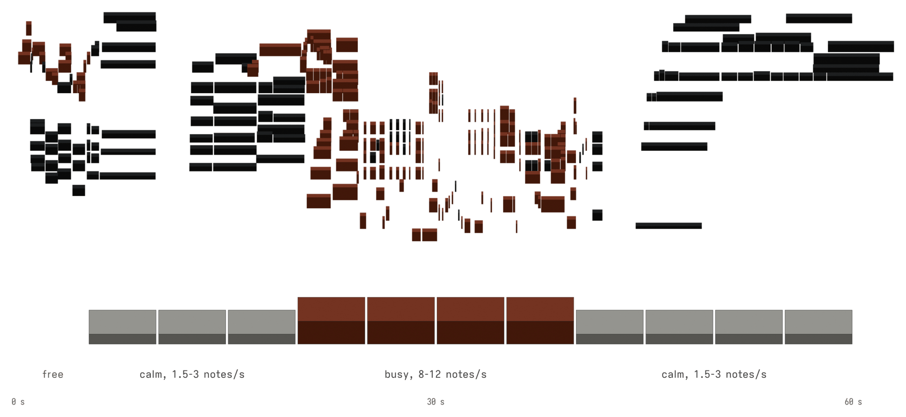
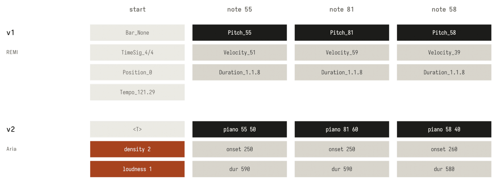
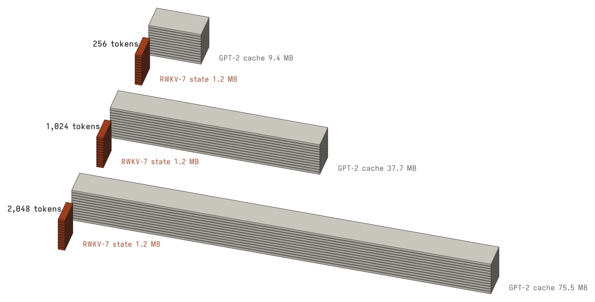
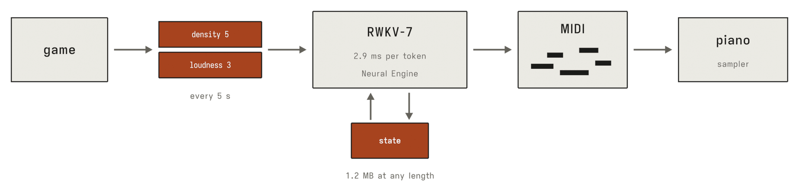

# GPT-2 piano and RWKV-7 piano

Two small language models that write piano music as MIDI. They work like a text model, except that the text is
notes.

- **v1** is a GPT-2 (87M parameters) trained on MAESTRO. You give it a piano passage and it continues it.
- **v2** is an RWKV-7 (93M parameters) trained on Aria-MIDI. It can keep playing for as long as needed while a
  game sets how dense and how loud the music should be every five seconds. One token costs about 3 ms on the
  Neural Engine of an M1 Pro, so it can run next to a game without taking its CPU or GPU.

Showcase: <https://herrei.github.io/gpt2-piano-mps-12k/>. Notes with every measurement:
[`report/notes.pdf`](report/notes.pdf).

<picture>
  <source media="(prefers-color-scheme: dark)" srcset="figures/controls-dark.png">
  
</picture>

*v2 asked for calm, busy and calm again (`examples/v2-calm-busy-calm.mid`, seed 0). Orange notes have a
velocity of 65 or more; the strip shows the density level asked for in each 5-s segment.*

## What is in this repository

| Path | What |
|---|---|
| `v1/prepare_data.py` | MAESTRO split, transposition of the training files, REMI tokens |
| `v1/train.py` | v1 training (MPS, CUDA/ROCm or CPU) |
| `v1/generate.py` | continue a MIDI file with v1 |
| `v2/tokenize_aria.py` | Aria-MIDI to token shards |
| `v2/vocab.py` | v2 vocabulary and the density and loudness control tokens |
| `v2/model.py`, `v2/train.py` | v2 training with flash-linear-attention (one or two GPUs) |
| `v2/rwkv7_step.py` | the same RWKV-7 one token at a time, in plain PyTorch |
| `v2/generate.py` | generate with v2 on the CPU, with controls, a prompt or guidance |
| `v2/coreml.py` | convert v2 to Core ML and time it on the Neural Engine |
| `v2/export.py` | training checkpoint to the released weights file |
| `eval/compare.py` | compare generated music with real playing |
| `examples/` | one MIDI file from each model |
| `figures/` | the figures in this README, rendered with Blender |
| `report/` | the notes as LaTeX and PDF |

## Weights

Both weights files are attached to the release
[`weights-2026-11`](https://github.com/HerRei/gpt2-piano-mps-12k/releases/tag/weights-2026-11).

| File | Model | Size | sha256 |
|---|---|---|---|
| `v1-gpt2-piano.safetensors` | v1, epoch 2 of the retraining | 348 MB | `fb8d3fdf2b7ed9e42afca8799bb146b4ba500647b7543b81ea5ff6091d43d25e` |
| `v2-rwkv7-piano.safetensors` | v2 after the second pass, step 17,509 | 374 MB | `387b1dda840c11f399ce982b0f19fa5697809dec224a0023260ae7c3c40548e2` |

The weights are fp32 safetensors. Their licence is CC BY-NC-SA 4.0 (see [Licences](#licences)).

The original v1 run on an M1 Max reached a validation loss of 1.43; its weights were lost. The released v1 is a
retraining with the same recipe in `v1/train.py`, on a Radeon RX 9060 XT in bf16. Like the original, it did best
after the second of four epochs and got worse after that, so the released weights are from epoch 2.

## Quick start

```bash
python3 -m venv .venv && . .venv/bin/activate
pip install -r requirements.txt
```

v2, a minute that goes from calm to busy and back:

```bash
python v2/generate.py --weights v2-rwkv7-piano.safetensors --plan 2,1:20 5,3:20 2,1:20 --out arc.mid
```

`--plan` takes `density,loudness:seconds`. Density levels are notes per second (0 below 0.5, 1 below 1.5, 2 below
3, 3 below 5, 4 below 8, 5 below 12, 6 below 18, 7 more); loudness levels are mean velocity (0 below 45, 1 below
55, 2 below 65, 3 below 75, 4 louder). `--free --seconds 60` plays without controls, and
`--prompt piece.mid` continues the first 20 s of a file.

v1, continuing a piece:

```bash
python v1/generate.py --weights v1-gpt2-piano.safetensors --prompt piece.mid --prompt_seconds 20 --seconds 40 \
    --out continued.mid
```

Without the two seconds options it continues the last 512 tokens of the file by 1,024 tokens.

Both scripts write MIDI and make no sound; any piano sampler or DAW plays the result. On the CPU, v2 takes
about 18 ms per token in plain PyTorch. On a Mac, `v2/coreml.py` (needs `pip install coremltools`) converts it
for the Neural Engine and times it:

```bash
python v2/coreml.py --weights v2-rwkv7-piano.safetensors --precision int8
```

## How the two models see music

<picture>
  <source media="(prefers-color-scheme: dark)" srcset="figures/tokens-dark.png">
  
</picture>

*The same three notes from `examples/v2-calm-busy-calm.mid` in both tokenizations, token strings exactly as the
tokenizers produce them.*

| | v1 | v2 |
|---|---|---|
| Architecture | GPT-2, 12 layers x 768, 12 heads | RWKV-7, 12 layers x 768, head size 64 |
| Parameters | 87.0M | 93.4M |
| Tokens | MidiTok REMI: bars and beat positions, 423 tokens | Aria: absolute time with a `<T>` every 5 s, trimmed to 2,144 + 15 control tokens |
| Memory of the past | attention over a 2,048-token window | a fixed-size state; trained on 1,024-token windows |
| Data | MAESTRO v3, about 200 hours | Aria-MIDI (pruned), 4.59B tokens |
| Steering | the prompt only | density and loudness every 5 s, plus the prompt |
| Validation loss | 1.4131 | 1.7493 |

Losses are cross-entropy in nats per token on held-out music. The two models use different tokens and data, so
their losses cannot be compared with each other.

After every `<T>` come two control tokens that describe the next five seconds: a density level and a loudness
level. In training they are computed from the real notes and are inputs only, never predicted. 15 % of the
segments get "none" instead, so the same model also plays without controls and supports classifier-free guidance.

## Why a recurrent model for live music

<picture>
  <source media="(prefers-color-scheme: dark)" srcset="figures/memory-dark.png">
  
</picture>

*Memory one stream carries, in fp16, with each model's own size (12 layers, width 768). Bars are to scale.*

A transformer keeps the keys and values of every token it has played, so its memory and the work per token grow
with the music. Core ML's own key-value cache did not compile for the Neural Engine at any size I tried, and
passing the cache in and out by hand cost about 13 ms per token with a 512-token window. RWKV-7 keeps a state of fixed size and does the
same fixed-shape computation for every token, which the Neural Engine accepts.

<picture>
  <source media="(prefers-color-scheme: dark)" srcset="figures/loop-dark.png">
  
</picture>

Measured on an M1 Pro (on mains power, Low Power Mode off, 5 Nov 2026) with `v2/coreml.py`:

| Neural Engine, int8 weights | Median | 99th percentile |
|---|---|---|
| one stream | 2.86 ms | 3.03 ms |
| two streams (guidance) | 5.73 ms | 5.98 ms |

The int8 model picks the same top token as fp32 PyTorch on 127 of 128 steps. Music needs about 30 tokens per
second on average and 83 in the busiest 1 % of seconds, which is 12 ms per token. Generating a second or two
ahead covers the densest bursts. On battery, with the first-pass weights, one stream took 4.03 ms (26 Oct 2026). How much it disturbs a game running at
the same time is not measured yet.

## Results in short

- **v2 controls.** On the first-pass model, without guidance, the music lands in the asked density band 93 % of
  the time and follows every switch within the first 5-s segment. On a 15-minute stream it still hits 88 % in
  minutes 10 to 14. Guidance at 0.5 raises the late hit rate to 99 %.
- **Second pass.** Training the same data a second time from the checkpoint before the learning-rate decay took
  the validation loss from 1.7929 to 1.7493.
- **Compared with real playing.** On 96 held-out recordings, a classifier on note statistics tells the second
  pass apart from the real continuation with an AUC of 0.64 (95 % interval 0.59 to 0.69), against 0.68 for the
  first pass. 0.5 would mean it cannot tell. Damaged copies of the real pieces score from 0.62 (5 % wrong notes)
  to 1.00. What still gives the model away is variety: fewer different intervals, flatter loudness and less
  varied rhythm. No listener has rated it.
- **v1.** The retraining reached a validation loss of 1.4131, against 1.43 for the original run. It has not been
  compared with real playing yet.

The notes in `report/` have the tables, the method of each test and what went wrong on the way.

## Training

v1, from the MAESTRO v3 MIDI folder:

```bash
python v1/prepare_data.py --maestro maestro-v3.0.0 --out data/v1
python v1/train.py --data data/v1 --out runs/v1 --epochs 4 --batch 8 --accum 2 --bf16
```

The split is random by file (seed 42, 90/5/5), not MAESTRO's official one, so related performances can land on
both sides. Only the training files are transposed (-3 to +3 semitones, when every note stays on the piano).
Updates use 16 windows of 2,048 tokens; on MPS the original run used `--batch 2 --accum 8` in fp32.

v2, from the pruned Aria-MIDI release:

```bash
pip install -r requirements-train-v2.txt
python v2/tokenize_aria.py aria-midi-v1-pruned-ext data/aria
python v2/train.py --data data/aria --out runs/v2
```

The defaults are the published run: 17,509 steps of 262,144 tokens (one pass over 4.59B tokens), AdamW with
betas (0.9, 0.99) and weight decay 0.1, learning rate 6e-4 after 500 warmup steps, constant until the last 20 %,
then 1 - sqrt decay to zero. It ran on an RX 9060 XT (bf16) and a Radeon VII (fp16) at about 29,000 tokens per
second, roughly 44 hours per pass; `v2/train.py` shows the two-GPU command. The second pass started from
`ckpt_predecay.pt` with `--init_from` and `--warmup 50`. `model.py` changes two things in flash-linear-attention
for AMD GPUs: a smaller kernel chunk size (4 to 6 times faster there) and fp32 for one kernel whose output
overflowed fp16.

`python v2/train.py --data data/aria --out runs/v2 --init_from <checkpoint> --eval_only 1` prints the validation
loss per token kind on the same 256 windows the training log uses.

## Limitations

- Neither model plans long-form structure. Themes do not come back on their own.
- v2's controls act every 5 s; faster changes need a layer outside the model.
- Aria-MIDI is transcribed from audio and carries transcription errors. Both datasets are mostly classical
  piano, so that is what the models play.
- The comparison with real playing uses statistics of the notes. It says nothing about whether the music is
  pleasant.
- The speed numbers are single model steps on one laptop, not measurements inside a game.

## Licences

- Code: MIT (`LICENSE`).
- Weights: CC BY-NC-SA 4.0 (`LICENSE-weights`), because both training sets carry that licence. Non-commercial
  use only.
- MAESTRO v3: Hawthorne et al., "Enabling Factorized Piano Music Modeling and Generation with the MAESTRO
  Dataset", ICLR 2019. CC BY-NC-SA 4.0. <https://magenta.tensorflow.org/datasets/maestro>
- Aria-MIDI: Bradshaw and Colton, "Aria-MIDI: A Dataset of Piano MIDI Files for Symbolic Music Modeling",
  ICLR 2025. CC BY-NC-SA 4.0. <https://github.com/loubbrad/aria-midi>
- The v2 tokenizer is `ariautils` from EleutherAI; v2 training uses flash-linear-attention.

The repository name is a leftover: "mps" from training v1 on Apple's MPS backend, "12k" from a working name. It
was never trained on 12,000 pieces.

## Citation

GitHub's "Cite this repository" button reads `CITATION.cff`.
